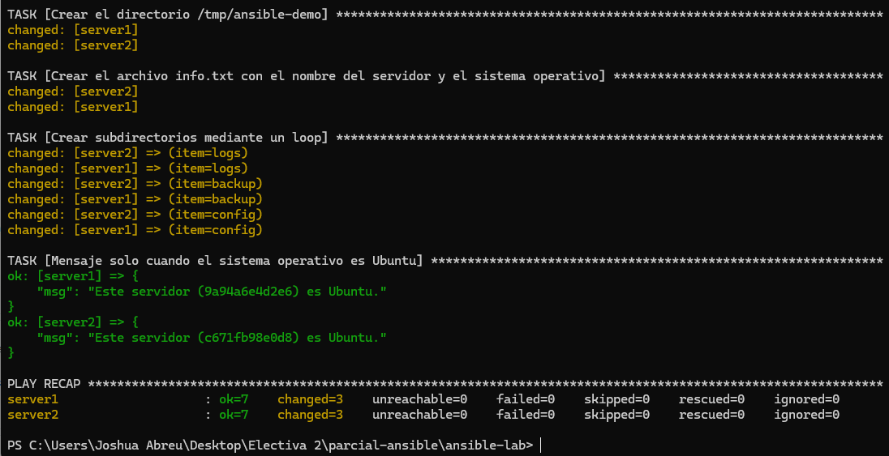

# Laboratorio Ansible + Docker

## Objetivo de la práctica

Crear un laboratorio con dos servidores Linux (contenedores Ubuntu 24.04 en Docker) y administrarlos con Ansible: verificar la conexión, ejecutar un playbook que muestra información del host y del sistema operativo, crea directorios y archivos, usa un `loop` y aplica una condición (`when`).

## Estructura

```text
ansible-lab/
├── docker-compose.yml
├── inventory.ini
├── playbook.yml
└── README.md
```

## Comandos para iniciar los contenedores

```bash
docker compose up -d
docker ps
```

Instalar Python en cada contenedor (requerido por Ansible):

```bash
docker exec server1 bash -c "apt update && apt install -y python3"
docker exec server2 bash -c "apt update && apt install -y python3"
```

Comprobar la conexión:

```bash
ansible docker -i inventory.ini -m ping
```

## Comando para ejecutar el playbook

```bash
ansible-playbook -i inventory.ini playbook.yml
```

## Captura de la ejecución exitosa


